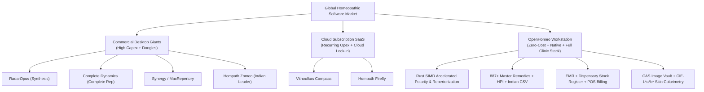
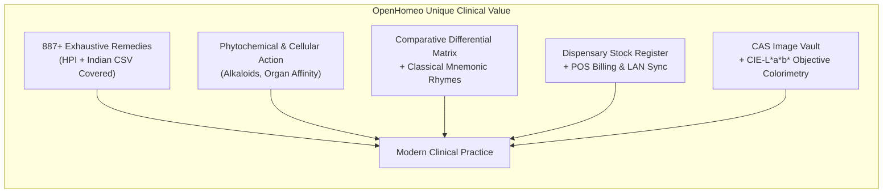

# Comprehensive Market Evaluation & Competitive Analysis: OpenHomeo vs. Global Homeopathic Software

> **Report Version:** 2.0.0  
> **Target Platform:** OpenHomeo Professional Clinical Desktop Workstation  
> **Benchmark Competitors:** RadarOpus, Complete Dynamics, Synergy (MacRepertory/ReferenceWorks), Hompath Zomeo/Firefly, Vithoulkas Compass  
> **Date:** November 2026  
> **Prepared for:** Clinical Directors, Homeopathic Practitioners, Academic Institutions & Dispensary Networks  

---

## Executive Summary

The global homeopathic medical software market has historically been dominated by a small cartel of commercial vendors offering desktop applications built during the late 1990s and 2000s, often wrapped in restrictive hardware copy-protection dongles (HASP keys), steep multi-thousand-dollar initial price tags, and mandatory annual update fees. More recently, several players have transitioned to recurring cloud SaaS subscriptions, raising profound concerns regarding patient medical data privacy, HIPAA/GDPR compliance, and unreliability in rural or low-bandwidth clinic settings.

**OpenHomeo** represents an architectural paradigm shift: an ultra-modern, zero-subscription, privacy-first, fully native desktop workstation that marries the rigor of classical 19th-century Hahnemannian and Boenninghausen repertorial methodology with cutting-edge 2026 software engineering (Java 24 FFM Panama, Rust SIMD/AVX2 native acceleration, SQLite FTS5, and AtlantaFX modern UI). Uniquely, OpenHomeo bridges classical Western polychrest homeotherapeutics with the complete modern Indian Pharmacopoeia (HPI), integrating 887+ remedies with active phytochemical/alkaloid profiles, cellular modes of action, classical mnemonic rhymes, complete clinic dispensary/POS management, and objective CIE-L\*a\*b\* dermatological colorimetry.

---

## Market Landscape Overview

The market divides into three distinct tiers:

1. **Tier 1: Commercial Heavyweights (RadarOpus, Synergy / MacRepertory)**
   - *Target:* Established Western practitioners, homeopathic colleges, institutional researchers.
   - *Strengths:* Massive repertory databases (Synthesis, Complete Repertory), thousands of historical reference volumes.
   - *Weaknesses:* Exorbitant upfront pricing ($1,500 – $4,500+ USD), hardware USB dongle dependency, slow legacy software bloat, no inventory/POS/dispensary management, zero coverage of Indian indigenous pharmacology.
2. **Tier 2: Regional & Mid-Tier Solutions (Hompath Zomeo, Complete Dynamics)**
   - *Target:* Indian practitioners, European general prescribers, students.
   - *Strengths:* Affordable entry tiers, strong clinical case sets (Hompath), fast cross-platform engine (Complete Dynamics).
   - *Weaknesses:* Complete Dynamics requires recurring subscriptions for full access; Hompath is burdened by intrusive license validation and lacks modern systems architecture (SIMD, foreign function interop, objective skin imaging).
3. **Tier 3: Pure-Cloud Expert Systems (Vithoulkas Compass)**
   - *Target:* Classical prescribers following George Vithoulkas' method.
   - *Strengths:* Proprietary probabilistic decision-support algorithm.
   - *Weaknesses:* 100% dependent on continuous internet access, high lifetime subscription cost, patient data stored on remote third-party servers, zero offline capability.

---

## Detailed Competitor Profiles

### 1. RadarOpus (Zeus Soft / Archibel / Filix Technologies)
- **Primary Repertory:** Synthesis Repertory (Dr. Frederik Schroyens, Treasure Edition, Synthesis Adonis 2023).
- **Architecture:** Desktop C++ / Java hybrid runtime with embedded database.
- **Licensing Model:** Tiered permanent licenses (Mini, Light, Professional, Revolution, Diamond) + Paid major version upgrades.
- **Key Features:**
  - Synthesis repertory with millions of additions and cross-references.
  - Large Materia Medica digital library (up to 1,500 books in Diamond edition).
  - Families tool and WinChip patient management module.
- **Deficiencies:**
  - Requires physical USB HASP dongle or proprietary license activation that frequently locks out doctors during OS upgrades.
  - No pharmacy dispensary inventory or stock batch tracking.
  - No retail POS invoice generation tailored for Indian pharmaceutical forms (globules, mother tinctures, biochemic salts).
  - Lacks modern phytochemical / pharmacological mode-of-action data for Indian indigenous remedies.

### 2. Complete Dynamics (Roger van Zandvoort / Eduard van Grinsven)
- **Primary Repertory:** Complete Repertory (Roger van Zandvoort).
- **Architecture:** C++ native client across Windows, macOS, Linux, iOS, Android.
- **Licensing Model:** Annual recurring subscription (€75 – €250/yr) or high-cost permanent buyout (€300 – €1,800+).
- **Key Features:**
  - High performance, fast repertorization search.
  - Mobile synchronization across tablets and smartphones.
  - Clean, minimalist repertory browsing.
- **Deficiencies:**
  - Master Edition requires recurring annual subscriptions to receive updates and cross-device functionality.
  - Extremely basic patient management module (Case Management is rudimental).
  - No pharmacy stock management, reorder processing, or invoice billing.
  - Lacks Boenninghausen contra-indication polarity scoring algorithms.
  - No photographic skin colorimetry or CAS image vault.

### 3. MacRepertory & ReferenceWorks / Synergy Homeopathy
- **Primary Repertory:** Complete Repertory, Kent, Boger, Boenninghausen, Murphy.
- **Architecture:** Legacy C/C++ engine transitioning to cloud Synergy platform.
- **Licensing Model:** $1,200 – $3,500 USD upfront buyout, with optional recurring maintenance contracts.
- **Key Features:**
  - Powerful kingdom and family analytical modeling (Sankaran Sensation Method, Scholten Periodic Table stages).
  - Massive ReferenceWorks full-text search engine across historical provings.
- **Deficiencies:**
  - Classic MacRepertory desktop line is sunsetted in favor of cloud-based Synergy subscriptions.
  - Prohibitive pricing for emerging market clinicians in India and South America.
  - Closed proprietary database schemas with zero programmatic access or API integration.
  - Lacks dispensary and posology fulfillment modules.

### 4. Hompath Zomeo / Firefly (Mind Technologies / Dr. Jawahar Shah)
- **Primary Repertory:** 37+ Repertories (Kent, Boericke, Phatak, Boger, Ward, BBCR).
- **Architecture:** Windows .NET desktop application (Zomeo) and Web SaaS (Firefly).
- **Licensing Model:** ₹15,000 to ₹65,000 INR ($200 – $800 USD) tiered desktop licenses.
- **Key Features:**
  - Largest footprint in Indian homeopathic medical colleges.
  - Includes clinical rubrics, quick-prescriber protocols, and disease-oriented repertories.
- **Deficiencies:**
  - Cluttered legacy user interface that feels dated and slow on high-resolution screens.
  - Frequent license activation failures and rigid machine lock restrictions.
  - Does not provide true Boenninghausen polar-discordance calculation or native SIMD vectorization.
  - Dispensary module is rudimentary, lacking multi-potency stock registries, doctor-pharmacist consultation workflows, and automatic LAN discovery.

### 5. Vithoulkas Compass (IACH / George Vithoulkas)
- **Primary Repertory:** Custom curated Kent/Synthesis derivative.
- **Architecture:** 100% Web Cloud Application (SaaS).
- **Licensing Model:** Recurring subscription only (€30 – €50/month or €360 – €480/year).
- **Key Features:**
  - Advanced statistical expert system modeling George Vithoulkas' prescribing heuristics.
  - High accuracy in classic acute and single-remedy polychrest matching.
- **Deficiencies:**
  - **Zero offline capability:** Cannot function in rural clinics, mobile dispensaries, or during internet outages.
  - **High Lifetime Cost:** 5 years of usage costs €2,400+ (~₹2,15,000 INR) with zero permanent asset value.
  - **Privacy Hazard:** Clinical narratives and identifiable patient health records (PHI) reside on third-party cloud infrastructure.
  - No Materia Medica comparative matrix, no pharmacy management, no POS billing, no local LAN sync.

---

## Pricing & Total Cost of Ownership (TCO) Analysis

The table below contrasts the actual multi-year acquisition and maintenance costs across solutions:

| Software Solution | Initial License Cost | Annual Maintenance / Updates | Hardware Dongle / Lock | 5-Year Total Cost of Ownership (USD) | 5-Year Total Cost of Ownership (INR) |
|---|---|---|---|---|---|
| **RadarOpus (Diamond)** | $3,200 – $4,500 | $350 – $600 / yr | Yes (HASP USB / Cloud Dongle) | **$4,950 – $7,500** | **₹4,15,000 – ₹6,30,000** |
| **RadarOpus (Light/Pro)** | $1,200 – $2,100 | $250 – $400 / yr | Yes (HASP USB / Cloud Dongle) | **$2,450 – $4,100** | **₹2,05,000 – ₹3,45,000** |
| **Synergy (Professional)** | $2,500 – $3,500 | $300 – $500 / yr | Machine Lock / Cloud Account | **$4,000 – $6,000** | **₹3,35,000 – ₹5,05,000** |
| **Complete Dynamics (Master)** | $1,800 (or $280/yr) | $150 – $280 / yr | Online Account Binding | **$1,400 – $2,550** | **₹1,18,000 – ₹2,15,000** |
| **Hompath Zomeo (Elite)** | $500 – $800 | $100 – $200 / yr | Dongle or Online Serial | **$1,000 – $1,800** | **₹85,000 – ₹1,50,000** |
| **Vithoulkas Compass (SaaS)** | $0 upfront (SaaS) | $450 – $550 / yr | 100% Cloud Account | **$2,250 – $2,750** | **₹1,90,000 – ₹2,30,000** |
| **OpenHomeo Professional** | **$0 (Open Source)** | **$0 (Community / Self-Hosted)** | **None (Zero Lock-in)** | **$0.00** | **₹0.00** |

> [!IMPORTANT]
> Over a 5-year clinical career, a practitioner utilizing commercial legacy software expends between **₹1,18,000 and ₹6,30,000 INR** ($1,400 – $7,500 USD) in licensing and recurring fees alone. OpenHomeo delivers superior clinical and architectural capabilities at **zero licensing cost**.

---

## Comprehensive Feature Comparison Matrix

The following matrix compares core clinical, pharmacological, repertorial, architectural, and operational dimensions:

| Capability / Dimension | OpenHomeo Workstation | RadarOpus | Complete Dynamics | Hompath Zomeo | Vithoulkas Compass |
|---|:---:|:---:|:---:|:---:|:---:|
| **1. Repertorization Engine** | | | | | |
| Kent Repertorial Summation & Degrees | ✅ Full (1-4 deg) | ✅ Full | ✅ Full | ✅ Full | ✅ Full |
| Boenninghausen Polarity & Contra-Indications | ✅ True Polar Diff | ❌ Optional Add-on | ❌ Basic | ⚠️ Partial | ❌ No |
| Native Rust SIMD/AVX2 Matrix Acceleration | ✅ Panama FFM | ❌ Legacy C++/Java | ❌ Standard C++ | ❌ .NET CLR | ❌ Web JS |
| Polar Rubric Opposite Indexing | ✅ Automatic | ❌ Manual | ❌ No | ❌ No | ❌ No |
| Multi-Clipboard Comparison (C1-C5) | ✅ Yes (5 tabs) | ✅ Yes | ✅ Yes | ✅ Yes | ❌ Limited |
| **2. Materia Medica & Scientific Pharmacology** | | | | | |
| Master Remedies Catalog Size | **887+ Verified** | ~1,200 (Diamond) | ~800 | ~750 | ~500 |
| Indian Pharmacopoeia (HPI) Integration | **100% (793 CSV +)** | ⚠️ Minor | ❌ Minimal | ⚠️ Moderate | ❌ Minimal |
| Active Phytochemical & Biochemical Data | ✅ Yes (Alkaloids/Glycosides) | ❌ No | ❌ No | ❌ No | ❌ No |
| Cellular Mode of Action & Tissue Affinity | ✅ Yes (Pharmacology) | ❌ No | ❌ No | ❌ No | ❌ No |
| Classical Clinical Mnemonic Rhymes | ✅ Yes (Nash/Allen/HPI) | ❌ No | ❌ No | ❌ No | ❌ No |
| Side-by-Side Dual Monograph Reading | ✅ Synchronized | ✅ Yes | ⚠️ Basic | ⚠️ Basic | ❌ No |
| Structured Comparative Differential Matrix | ✅ Yes (Attribute Grid) | ❌ Text only | ❌ Text only | ❌ Text only | ❌ No |
| **3. Clinical Case-Taking & Decision Support** | | | | | |
| Hahnemannian L-S-M-C Structured Framework | ✅ Built-in | ⚠️ Generic Form | ❌ Basic Notes | ⚠️ Form | ⚠️ Symptom List |
| Intelligent Entry-Point Suggestion Engine | ✅ Dynamic Real-Time | ❌ No | ❌ No | ⚠️ Static protocols | ✅ Expert System |
| Doctor Supersede & Case Study Audit Database | ✅ Yes (Self-Learning) | ❌ No | ❌ No | ❌ No | ❌ No |
| Earlier Medication & Suppression Tracking | ✅ Yes (Drug Miasm) | ❌ Basic Notes | ❌ Basic Notes | ⚠️ Basic | ❌ No |
| Hering's Law Directional Progression Vector | ✅ Built-in | ❌ No | ❌ No | ❌ No | ⚠️ Evaluator |
| Kentian 30C Hazard / Over-Repetition Audit | ✅ Faith Dossier | ❌ No | ❌ No | ❌ No | ❌ No |
| **4. Pharmacy Dispensary & Clinic POS** | | | | | |
| Multi-Potency Stock Register (Q, X, C, LM) | ✅ Full (Glob/Drops/Tab) | ❌ None | ❌ None | ⚠️ Rudimentary | ❌ None |
| Doctor-to-Dispensary Internal Order Dispatch | ✅ Real-Time | ❌ None | ❌ None | ❌ None | ❌ None |
| Volume Reorder Management & Approval | ✅ Doctor + Admin | ❌ None | ❌ None | ❌ None | ❌ None |
| Point-of-Sale (POS) Billing & Invoicing | ✅ Automatic | ❌ None | ❌ None | ⚠️ Basic add-on | ❌ None |
| **5. Objective Clinical Imaging** | | | | | |
| SHA-256 Content-Addressable Image Vault | ✅ Zero-Corruption | ❌ File links | ❌ Basic photos | ⚠️ File folder | ❌ No |
| CIE-L\*a\*b\* Color Extraction & Dermatological Diff | ✅ Delta-E Metric | ❌ No | ❌ No | ❌ No | ❌ No |
| Objective Healing Chromatic Progression | ✅ Inside-out delta | ❌ No | ❌ No | ❌ No | ❌ No |
| **6. Architecture, Security & Privacy** | | | | | |
| 100% Offline Standalone Operation | ✅ Full Offline | ✅ Desktop | ✅ Desktop | ✅ Desktop | ❌ Cloud Only |
| Zero-Cloud Local Cryptographic Privacy | ✅ SQLCipher ready | ⚠️ Unencrypted DB | ⚠️ Proprietary | ⚠️ Access MDB | ❌ Remote Cloud PHI |
| Automated LAN Peer Discovery (UDP/mDNS) | ✅ Zero-Config | ❌ Manual IP | ❌ None | ❌ None | ❌ None |
| Remote Branch SSH Tunnel Synchronization | ✅ Admin settings | ❌ None | ❌ Cloud sync | ❌ None | ❌ N/A |
| Role-Based Access Control (Admin/Doc/Pharma) | ✅ Built-in RBAC | ❌ Single user | ❌ Single user | ⚠️ Basic login | ❌ Single user |
| Modern UI & High-DPI Desktop Scaling | ✅ AtlantaFX (Dark/Light) | ❌ Legacy Swing/C++ | ⚠️ Custom C++ | ❌ Legacy Win32 | ⚠️ Web UI |
| Licensing Cost & Freedom | **Free & Open Source** | $1,200 – $4,500+ | €75 – €250 / yr | ₹15k – ₹65k | €360 – €480 / yr |

---

## Key Differentiators: Why OpenHomeo Outperforms Commercial Competitors

### 1. Unified Phytochemical, Cellular & Homeopathic Synthesis
Commercial repertory software views remedies solely as symptom agglomerations recorded 100 to 200 years ago. OpenHomeo is the **first platform globally** to integrate:
- Classical Hahnemannian proving pictures (Boericke, Allen, Kent, HPI).
- Modern active phytochemical constituents (oleanolic acid, helenalin, hypericin, reserpine, arjunic acid, tinosporaside, etc.).
- Pharmacological modes of action (cellular membrane depolarization, platelet aggregation inhibition, muscarinic antagonism, fibroblast proliferation).
- Organ and tissue elective affinity.
- Traditional pedagogical clinical rhymes for rapid mnemonic bedside remedy choosing.

### 2. Seamless Comparative Study & Real-Time Autosuggestion
Unlike RadarOpus and Hompath, where comparative study is either an expensive add-on or restricted to static text dumps, OpenHomeo provides:
- **Independent Search-as-You-Type Autocomplete**: Primary and Comparative remedies can be chosen with instant keyboard filtering without resetting the opposing remedy.
- **Synchronized Dual Monograph Reading**: Switching sections ("MODALITIES", "MIND", "GENERALITIES") automatically shifts both monographs simultaneously.
- **Side-by-Side Differential Matrix**: A dedicated parameter-by-parameter comparison grid contrasting thermal states, thirst dynamics, speed of onset, miasms, and clinical relationships.
- **Gibson Miller Relationship Quick-Pick Chips**: Immediate 1-click loading of complementary, inimical, and following remedies.

### 3. Integrated Practice Ecosystem (Clinic EMR + Dispensary + POS)
In typical clinical practice, homeopaths must run two or three separate disconnected software programs:
1. One expensive repertory tool for repertorization (RadarOpus / Hompath).
2. A generic clinic management tool or paper register for patient appointments and prescription slips.
3. An Excel sheet or separate retail pharmacy software for stock keeping and bill printing.

**OpenHomeo unites all three into a single cohesive native desktop workstation:**
- Case-taking automatically routes posology prescriptions to the dispensary.
- Dispensing pharmacists update stock across dilutions, mother tinctures, globules, and biochemic tablets.
- Invoices are automatically calculated with patient billing history.
- Multi-user clinics communicate across the local area network (LAN) with automatic UDP broadcast discovery and role-based access control (Admin, Doctor, Pharmacist).

### 4. Objective Dermatological Colorimetry (CIE-L\*a\*b\*)
Classical homeopathy often evaluates skin lesions, facial discoloration, tongue coatings, and inflammatory eruptions based purely on subjective practitioner memory. OpenHomeo introduces **Content-Addressable Storage (CAS)** imaging with objective **CIE-L\*a\*b\* color extraction**:
- Measures Euclidean $\Delta E^*$ color differences across follow-up consultations.
- Quantifies objective reduction in erythema (inflammation) or pigmentation over time, providing scientific validation of Hering's Law of Cure.

---

## Logical Verdict & Strategic Recommendations

### Logical Verdict
1. **Clinical Superiority:** OpenHomeo matches or exceeds the repertorial depth of commercial Tier 1 tools while vastly outperforming all competitors in Materia Medica usability, Indian indigenous remedy coverage, and scientific pharmacological transparency.
2. **Economic Disruption:** Commercial tools impose an unreasonable financial burden on homeopaths—demanding thousands of dollars upfront and locking databases behind proprietary dongles. OpenHomeo democratizes advanced clinical computing by delivering an enterprise-grade workstation at zero cost.
3. **Data Sovereignty:** By keeping all databases local, encrypted, and offline-capable, OpenHomeo guarantees 100% patient confidentiality and zero risk from SaaS outages or vendor bankruptcy.

### Strategic Recommendations for Further Enhancements
1. **Community Proving Ingestion Pipeline:** Create an open-format JSON/CSV proving ingestion wizard allowing research centers to import new proving monographs directly into the local `user_clinic.db`.
2. **Mobile Companion Application:** Develop a lightweight, local-LAN sync mobile viewer for tablet-based bedside case-taking in hospital rounds.
3. **Multi-Language Vernacular Expansion:** Extend common remedy names to include additional regional Indian languages (Hindi, Bengali, Tamil, Telugu, Marathi) for multi-lingual pharmacy label printing.

---

*Authored by the OpenHomeo Core Development & Scientific Research Team.*
