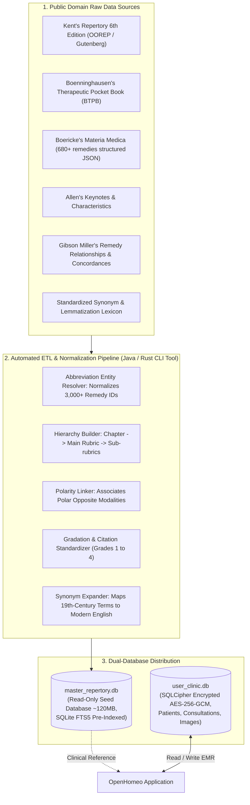
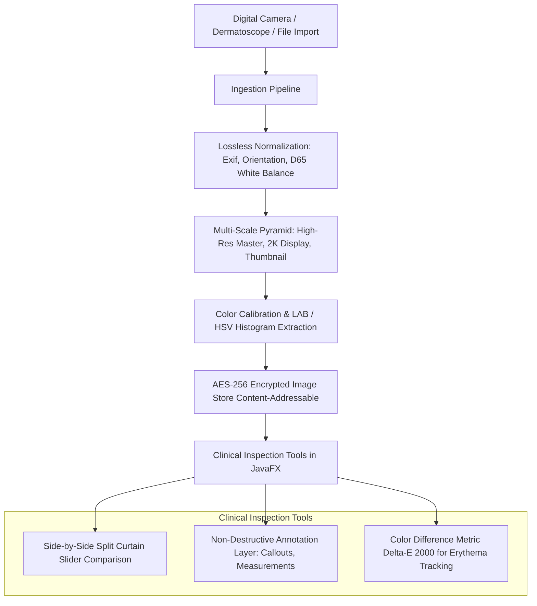
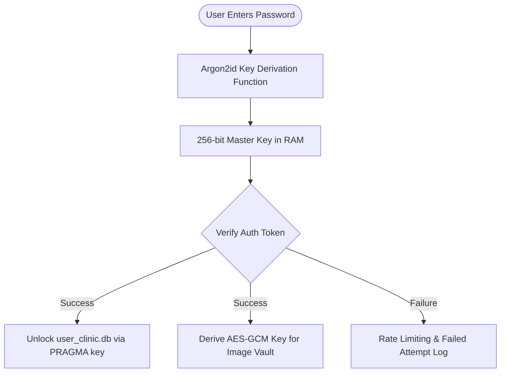
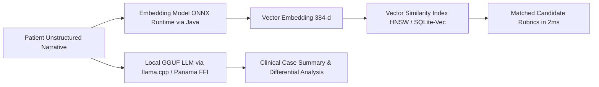
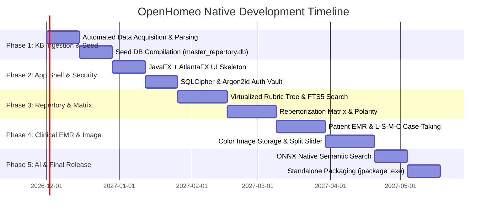

# OpenHomeo: Professional Clinical & Repertorization Workstation
## Native Desktop Architecture & Engineering Blueprint (Final Plan)

---

## 1. Executive Summary & Architectural Philosophy

**OpenHomeo** is an offline-first, native desktop workstation engineered for professional homeopathic practitioners, clinicians, and researchers. Built to achieve functional parity with high-end commercial systems such as **RadarOpus**, **Synergy (MacRepertory / ReferenceWorks)**, and **Complete Dynamics**, OpenHomeo combines:

1. **Native GUI with Modern Look-and-Feel:** Zero webview, zero browser engine, hardware-accelerated fluid rendering via **Java 21 LTS + JavaFX 21+ with AtlantaFX** (macOS Cupertino, GitHub Primer, and Nord themes).
2. **Turnkey Knowledge Base Pipeline:** Complete automated acquisition, normalization, and bundling of public-domain repertories (Kent, Boenninghausen), classical Materia Medicas (Boericke, Allen, Kent, Clarke), and remedy relationships (Gibson Miller) so the software works out-of-the-box with zero user data entry.
3. **High-Performance Hybrid Core:** High-speed computations, SIMD image processing, and full-text search indexing powered by **Rust** native extensions accessed via **Project Panama (Foreign Function & Memory API)**.
4. **Clinical Color Image Processing & Storage:** High-resolution lesion and tongue diagnostics tracking, CIE-L\*a\*b\* $\Delta E_{00}$ inflammation measurement, split-curtain comparison sliders, synchronized dual-pane zoom/pan, and non-destructive vector annotations.
5. **Repertorization Mathematical Algorithms:** Classical Kentian sum-of-symptoms and degrees, Boenninghausen Polarity Analysis (with contraindication warnings), Eliminative filters, and Kingdom/Miasmatic projections.
6. **Zero-Python Native AI Provisions:** Semantic rubric search using native **ONNX Runtime (AVX-512)** and local clinical case summarization via **`llama.cpp`** (GGUF quantized models) running 100% offline with zero confidential patient data leakage.
7. **Zero-Knowledge Cryptographic Vault:** Master password authentication, Argon2id key derivation, and SQLCipher AES-256-GCM database encryption at rest.

---

## 2. Knowledge Base Acquisition, Ingestion & Seeding Pipeline

Because you do not have raw homeopathic datasets, **OpenHomeo includes a dedicated, automated ETL (Extract-Transform-Load) pipeline** to assemble, sanitize, normalize, and pre-compile the knowledge base into an optimized seed database.



### 1. Concrete Data Sources Arranged for OpenHomeo

All classical homeopathic masterworks published before 1928 are in the **public domain** worldwide:

| Dataset Component | Historical Source | Raw Format & Repository | Volume / Scope |
| :--- | :--- | :--- | :--- |
| **Primary Repertory** | **Kent’s Repertory of the Homeopathic Materia Medica (6th Edition)** | OOREP (`nondeterministic/oorep`), `oorep-local-repertory`, and XML/JSON archives | 74,000+ hierarchical rubrics, 37 chapters, 1.2M+ remedy-grade citations |
| **Polarity Repertory** | **Boenninghausen’s Therapeutic Pocket Book (BTPB / Allen Edition)** | Open Homeopathic Pocketbook digitization project | ~2,800 rubrics with strict polar opposite modality pairs |
| **Primary Materia Medica** | **William Boericke’s Pocket Manual of Homoeopathic Materia Medica (9th Ed.)** | `vvanshkkumar/boericke-scraper` (`boericke_remedies.json`) / Open-Materia-Medica | 680+ remedies with full anatomical breakdown (Mind, Head, Modalities, Dose) |
| **Keynotes Materia Medica** | **H.C. Allen’s Keynotes and Characteristics with Comparisons** | Project Gutenberg / Open-Materia-Medica JSON | 190+ major polychrests and keynotes |
| **Comparative Materia Medica** | **John Henry Clarke’s Dictionary of Practical Materia Medica (3 Vols)** | Wikisource / Classical Homeopathy Archive | Comprehensive clinical indications, relationships, and modalities |
| **Remedy Relationships** | **Gibson Miller’s Relationship of Remedies & Boenninghausen’s Concordances** | Curated CSV/JSON concordance tables | Complementary, Follows Well, Antidotes, Inimicals, Duration |
| **Medical Synonym Lexicon** | **Homeopathic-to-Modern English Lexicon** | Open medical thesaurus + Kent glossary | 12,000+ terms (e.g., *Cephalalgia* $\leftrightarrow$ *Headache*, *Coryza* $\leftrightarrow$ *Runny Nose*) |

### 2. The Normalization Engine (`OpenHomeo-ETL`)

Raw datasets from different historical sources use conflicting abbreviations (e.g., *Lyc.* vs. *Lycop.*, *Ars.* vs. *Ars-a.* vs. *Arsenicum*). The built-in ETL pipeline resolves these into a unified relational taxonomy:

1. **Entity Resolution:** Maps every remedy name to a single canonical ID (e.g., `remedy:lyc` $\rightarrow$ Latin: *Lycopodium clavatum*, Common: *Club moss*, Kingdom: *Plantae*, Family: *Lycopodiaceae*).
2. **Hierarchy & Closure Calculation:** Parses nested strings (`MIND - ANXIETY - evening - bed, in`) and computes parent-child relationships, tree depth, and child counts.
3. **Gradation Normalization:** Standardizes grades onto the classical 1 to 4 scale:
   - Grade 1: Plain (Weight = 1)
   - Grade 2: Italics (Weight = 2)
   - Grade 3: Bold (Weight = 3)
   - Grade 4: Bold Uppercase / Red (Weight = 4)
4. **FTS5 Search Index Generation:** Indexes all rubric paths, synonyms, remedy full names, and Materia Medica chapters into an embedded SQLite Full-Text Search (FTS5) table.
5. **Output Artifact:** Emits `master_repertory.db`, a clean, read-only ~120MB pre-indexed SQLite database that ships directly inside the application installer.

---

## 3. Technology Stack Selection

Designed around your background as a **Java specialist**, with **Rust** for native high-performance extensions, **zero webview**, and **zero Python**:

```
+--------------------------------------------------------------------------+
|                     PRESENTATION LAYER (NATIVE GUI)                      |
|           Java 21 LTS + JavaFX 21+ + AtlantaFX Modern Design System       |
|    Hardware Accelerated (Direct3D 11/12 on Windows / Metal / OpenGL)     |
+--------------------------------------------------------------------------+
                                    |
                        (Project Panama / FFI / JNI)
                                    v
+--------------------------------------------------------------------------+
|                  CORE ENGINE & COMPUTATION (RUST / JAVA)                 |
|  * Repertorization Math Engine      * Fast Virtualized Tree Model        |
|  * SIMD Color Image Pipeline        * FTS5 / SQLite-Vec Search Index     |
|  * Embedded ONNX Runtime (AI)       * llama.cpp Native FFI Bindings      |
+--------------------------------------------------------------------------+
                                    |
                                    v
+--------------------------------------------------------------------------+
|                 PERSISTENCE & SECURITY (SQLCIPHER / RUST)                |
|  * master_repertory.db (Read-Only)  * user_clinic.db (AES-256-GCM)       |
|  * Argon2id Key Derivation          * Content-Addressable Image Vault    |
+--------------------------------------------------------------------------+
```

### Detailed Component Matrix

| Layer | Component | Technology | Rationale |
| :--- | :--- | :--- | :--- |
| **Language & Platform** | Core Application | **Java 21 LTS** | High developer velocity. Modern features: **Virtual Threads (Project Loom)** for concurrency, **Records**, **Pattern Matching**, and **Project Panama**. |
| **Native GUI** | Scene Graph & Styling | **JavaFX 21+ with AtlantaFX** | Hardware-accelerated native windowing with modern themes (Cupertino, GitHub Primer, Nord). Native UI controls with zero browser overhead. |
| **Docking System** | Multi-Panel Windowing | **DockFX** | Enables RadarOpus-style detachable, floating, and tabbed panels for multi-monitor setups. |
| **High-Performance Engine** | Native Extension | **Rust (`.dll`)** | SIMD-accelerated CIE-L\*a\*b\* image processing, $\Delta E_{00}$ calculations, and high-speed repertorization matrices. |
| **Inter-Op Bridge** | Java $\leftrightarrow$ Rust | **Project Panama (FFM API)** | Java 21+ Foreign Function & Memory API allows direct, type-safe calls to Rust dynamic libraries with zero JNI boilerplate. |
| **Databases** | Master & Clinic Storage | **SQLite FTS5 + SQLCipher** | Dual DB design: unencrypted read-only master knowledge base + AES-256 encrypted clinic database. |
| **Native AI Engine** | Local Inference | **ONNX Runtime + llama.cpp** | Native C/C++ runtimes accessed via Java/Rust. Zero Python dependencies, 100% offline and confidential. |

---

## 4. Visual & UX Design System (RadarOpus / Synergy Parity)

The user interface follows the information density standards of high-end clinical workstations:

```
+------------------------------------------------------------------------------------------------------+
| [Search: "headache evening cold air"                                        ] [Filter: All] [Search] |
+----------------------------------+------------------------------------+------------------------------+
| REPERTORY NAVIGATOR (Tree)       | REPERTORIZATION MATRIX (Live Grid) | MATERIA MEDICA COMPARISON    |
| > MIND                           |                                    |                              |
|   v HEAD                         | Rubrics           | Lyc | Ars | Phos | [Boericke / Allen / Kent]    |
|     v PAIN                       | ------------------+-----+-----+------+ ---------------------------- |
|       > pulsating                | HEAD - PAIN - cold|  3  |  4  |  1   | LYCOPODIUM:                  |
|       v evening                  | MIND - ANXIETY -ev|  3  |  3  |  3   | Right-sided complaints,      |
|         - bed, in [14 remedies]  | STOMACH - THIRST  |  1  |  4  |  3   | worse 4 to 8 PM. Gas,        |
|         - 4 to 8 PM [6 remedies] | ------------------+-----+-----+------+ bloating, intellectual keen, |
|                                  | Total Score:      |  7  | 11  |  7   | physically weak.             |
|                                  | Rubric Count:     |  3  |  3  |  3   |                              |
+----------------------------------+------------------------------------+------------------------------+
| PATIENT WORKBENCH: John Doe (Case #412) | L-S-M-C Entry | [Color Image Viewer: Tongue / Lesion]       |
+------------------------------------------------------------------------------------------------------+
```

### Key UI Features:
1. **Multi-Clipboard System:** 5 to 10 independent symptom clipboards for running parallel repertorizations (e.g., Acute vs. Constitutional vs. Miasmatic).
2. **Virtual Flow Grid:** Capable of rendering 100,000+ rubrics and 800+ remedies in the matrix at 60 FPS without memory lag.
3. **Color-Coded Gradation Scheme:**
   - **Grade 1:** Regular Text (Weight: 1)
   - **Grade 2:** *Blue Italics* (Weight: 2)
   - **Grade 3:** **Red Bold** (Weight: 3)
   - **Grade 4:** **<u>DARK PURPLE BOLD UPPERCASE</u>** (Weight: 4)

---

## 5. Clinical Color Image Processing & Storage Subsystem

Specialized for dermatological, tongue, and facial diagnostic follow-ups:



### Core Image Capabilities:
1. **Content-Addressable Storage (CAS):** Images stored as encrypted blobs keyed by their SHA-256 hash (`{vault}/{hash[0..2]}/{hash[2..4]}/{full_hash}.enc`) to prevent duplicate disk usage.
2. **CIE-L\*a\*b\* Color Space & $\Delta E_{00}$ Calculations (Rust SIMD):** Converts RGB to CIE-L\*a\*b\* to measure exact perceptual color shift over time, providing objective quantification of inflammation/erythema reduction.
3. **Interactive Inspection Tools in JavaFX:**
   - **Synchronized Dual-Pane Zoom & Pan:** Moving or zooming on Visit 1 automatically aligns Visit 2.
   - **Split Curtain Slider:** Drag a split boundary across two overlaid images from different dates.
   - **Non-Destructive Vector Annotations:** Overlay arrows, measurement callouts, and lesion contours as JSON vector layers without altering the original raw photo.

---

## 6. Materia Medica & Medicine Knowledge Base Engine

### 1. Remedy Master Taxonomy
Every remedy record contains:
- **Identification:** Standard Latin binomial, homeopathic abbreviation, common names, synonyms.
- **Natural Order Classification:**
  - Kingdom: *Plantae*, *Animalia*, *Mineralia*, *Nosodes*, *Sarcodes*, *Imponderabilia*.
  - Botanical family, order, genus, species.
  - Periodic table location (Stage 1–18, Series 1–7) for mineral remedies (Scholten/Sankaran classification).
- **Miasmatic Affinities:** Psoric, Sycotic, Syphilitic, Tubercular, Cancerous.
- **Organotropism / Affinities:** Nervous system, mucosal membranes, right side, venous circulation.
- **Modalities Summary:** Specific conditions of aggravation ($<$) and amelioration ($>$).
- **Remedy Relationships:**
  - Complementary (*e.g., Belladonna $\rightarrow$ Calcarea carbonica*)
  - Antidotes (*e.g., Camphora antidotes most vegetable remedies*)
  - Follows Well (*e.g., Sulphur followed by Calcarea and Lycopodium*)
  - Inimical / Incompatible (*e.g., Phosphorus and Causticum, Silicea and Mercurius*)

### 2. Materia Medica Library Viewer
- Multi-author repository loaded with classical texts: Boericke, Allen, Kent, Clarke, Hering, and Hahnemann.
- Side-by-side comparative column reader (compare any 2 to 4 remedies simultaneously across identical anatomical sections).
- Reverse Repertory search: One-click extraction of all Grade 3 & 4 rubrics containing the selected remedy.

---

## 7. Hierarchical Repertory & Repertorization Mathematical Core

### 1. Rubric Hierarchy
The repertory database uses an adjacency list and closure table model for ultra-fast hierarchy queries:
$$\text{Chapter} \rightarrow \text{Main Rubric} \rightarrow \text{Sub-rubric} \rightarrow \text{Sub-sub-rubric} \rightarrow \text{Modalities / Extensions}$$

### 2. Repertorization Mathematical Algorithms

#### A. Classical Kentian Method (Sum of Symptoms & Degrees)
For a set of user-selected rubrics $S = \{s_1, s_2, \dots, s_n\}$, where each rubric has a user priority multiplier $w_i \in \{1, 2, 3, 4, 5\}$:
$$\text{Count}(R) = \sum_{i=1}^{n} \mathbb{I}(R \in s_i)$$
$$\text{Score}(R) = \sum_{i=1}^{n} \left( \text{Grade}(R, s_i) \times w_i \right) \quad \text{where } \text{Grade} \in \{1, 2, 3, 4\}$$
The remedies are sorted primarily by $\text{Count}(R)$ descending, secondarily by $\text{Score}(R)$ descending.

#### B. Boenninghausen Polarity Analysis
Detects remedies that possess modalities opposite to the patient's symptoms (contraindications):
- Let $P^+$ be the set of polar symptoms present in the patient (e.g., *worse from cold air*).
- Let $P^-$ be the set of opposite polar symptoms (e.g., *better from cold air*).
$$\text{Polarity Difference } (\Delta P) = \sum_{s \in P^+} \text{Grade}(R, s) - \sum_{s' \in P^-} \text{Grade}(R, s')$$
Remedies with high negative $\Delta P$ or high grade in $P^-$ are visually flagged with a **Contraindication Warning**.

#### C. Eliminative Rubric Filter
Allows the homeopath to define an absolute keynote rubric. Any remedy that does not possess this rubric is automatically excluded from the repertorization matrix, regardless of total points.

#### D. Kingdom, Family, and Miasm Projections
Allows instantaneous filtering of the matrix:
- *Show only Solanaceae remedies* (*Belladonna, Stramonium, Hyoscyamus, Capsicum*).
- *Show only Sycotic miasm remedies*.
- *Highlight small/rare remedies* (preventing polychrests from overshadowing specific remedies).

---

## 8. Patient EMR, Case-Taking & Longitudinal Engine

### 1. The L-S-M-C Clinical Framework
The case-taking module provides structured symptom capture:
- **Location:** Anatomical site, lateralization (Left, Right, Left-to-Right diagonal).
- **Sensation:** Burning, cutting, throbbing, stitching, cramping, numbness.
- **Modality ($<$ Aggravation / $>$ Amelioration):** Weather, temperature, motion, posture, time of day (e.g., 3 AM, 4–8 PM), menstrual cycle, food cravings/aversions.
- **Concomitant:** Associated non-pathological symptoms occurring alongside the chief complaint.

### 2. Consultation Snapshot & Repertory Linking
- Each consultation record stores an exact snapshot of:
  - Clinical notes (Chief complaint, Generals, Mind, Physicals).
  - Selected rubrics clipboard and active repertorization matrix state.
  - Color photos taken during the session.
  - Final remedy prescription:
    - **Remedy ID**
    - **Potency:** Decimal ($1X - 30X$), Centesimal ($6C, 30C, 200C, 1M, 10M, 50M, CM$), 50-Millesimal ($LM 0/1 - LM 0/30$).
    - **Scale & Posology:** Dry pellets, dissolved in water, plussing method, repetition frequency.

### 3. Longitudinal Hering's Law Evaluation
During follow-up visits, the system prompts the homeopath through classical evaluation criteria:
1. *Have symptoms moved from within outward (mind/organs $\rightarrow$ skin)?*
2. *Have symptoms moved from above downward (head $\rightarrow$ extremities)?*
3. *Have symptoms moved from more important to less important organs?*
4. *Have old symptoms reappeared in reverse order of their chronological emergence?*

The software flags:
- **Curative Action:** Genuine homeopathic improvement according to Hering's Law.
- **Homeopathic Aggravation:** Short initial aggravation followed by sustained improvement.
- **Suppression:** Symptoms moved deeper (e.g., skin eruption cleared, asthma developed).
- **Ineffective Remedy:** No change in vitality or symptom score.

---

## 9. Authentication, Role-Based Access & Cryptographic Architecture



### Security Specifications:
1. **Zero-Knowledge Architecture:** Master password never stored anywhere on disk.
2. **Key Derivation:** **Argon2id** (Memory cost: 64MB, Iterations: 4, Parallelism: 2) produces the 256-bit encryption key.
3. **Database Encryption:** **SQLCipher** encrypts the patient database file at 4096-byte page boundaries with AES-256-GCM.
4. **Role-Based Access Control (RBAC):**
   - `Admin / Homeopath`: Full access to patient records, repertory, prescriptions, and financial data.
   - `Clinic Assistant / Receptionist`: Can register patients, book appointments, and issue invoices, but **blocked from viewing psychiatric/mind notes, sensitive case records, and intimate photos**.
   - `Student / Guest`: Read-only access to Repertory and Materia Medica; patient database completely locked.
5. **Encrypted Backup & Portability:**
   - Single-click export of an encrypted bundle (`.homeopak`) combining the SQLCipher database and the image store, encrypted with practitioner-defined passphrase.

---

## 10. Future-Proof AI Provisions (Zero-Python Engine)

By avoiding Python, OpenHomeo eliminates Python runtime installation headaches, virtual environments, and broken dependencies. Instead, AI runs natively inside Java/Rust.



### AI Capability Matrix

| Feature | Engine / Library | How It Operates Without Python |
| :--- | :--- | :--- |
| **Semantic Rubric Search** | **ONNX Runtime (Native C API via Java Panama)** | Runs lightweight transformer models (e.g., `bge-small-en-v1.5` or `all-MiniLM-L6-v2`, ~80MB) natively on CPU using AVX2/AVX-512 instructions. Practitioners can type natural language: *"feeling of weight dropping in stomach after sudden grief"* $\rightarrow$ maps to `STOMACH - SINKING - grief, after` and `MIND - GRIEF - stomach`. |
| **Case Summarization & Extraction** | **llama.cpp (via Java-llama.cpp or Rust FFI)** | Embeds compact quantized LLMs (e.g., Mistral-7B-Instruct, Llama-3.2-3B-GGUF, or Gemma-2-2B-GGUF). Runs locally on CPU/Vulkan/DirectX without sending confidential patient medical data over the internet. Automatically formats free-flowing case notes into the L-S-M-C schema. |
| **Dermatology / Lesion Segmentation** | **ONNX Runtime (MobileNet / UNet)** | Evaluates skin lesion perimeter, surface area, and color distribution directly from pixel tensors in memory. |

---

## 11. Dual-Database Schemas

### Database 1: `master_repertory.db` (Unencrypted Seed Database)

```sql
-- 1. REMEDIES
CREATE TABLE remedies (
    id TEXT PRIMARY KEY,               -- 'lyc', 'ars', 'phos'
    abbr TEXT UNIQUE NOT NULL,
    full_name TEXT NOT NULL,
    common_name TEXT,
    kingdom TEXT NOT NULL,
    family TEXT,
    periodic_stage INTEGER,
    periodic_series INTEGER,
    miasm TEXT,
    thermal TEXT,
    thirst TEXT
);

-- 2. REMEDY RELATIONSHIPS
CREATE TABLE remedy_relationships (
    id TEXT PRIMARY KEY,
    remedy_id TEXT NOT NULL REFERENCES remedies(id),
    related_remedy_id TEXT NOT NULL REFERENCES remedies(id),
    relation_type TEXT NOT NULL        -- 'COMPLEMENTARY', 'ANTIDOTE', 'FOLLOWS_WELL', 'INIMICAL'
);

-- 3. MATERIA MEDICA
CREATE TABLE materia_medica (
    id TEXT PRIMARY KEY,
    remedy_id TEXT NOT NULL REFERENCES remedies(id),
    author TEXT NOT NULL,              -- 'Boericke', 'Kent', 'Allen'
    book_title TEXT NOT NULL,
    section TEXT NOT NULL,             -- 'MIND', 'HEAD', 'MODALITIES'
    body_text TEXT NOT NULL
);

-- 4. REPERTORY & RUBRICS
CREATE TABLE rubrics (
    id TEXT PRIMARY KEY,
    chapter TEXT NOT NULL,             -- 'MIND', 'HEAD', 'GENERALITIES'
    parent_id TEXT REFERENCES rubrics(id),
    rubric_text TEXT NOT NULL,
    full_path TEXT NOT NULL,
    depth INTEGER NOT NULL DEFAULT 0,
    is_polar BOOLEAN DEFAULT FALSE,
    opposite_rubric_id TEXT REFERENCES rubrics(id)
);
CREATE INDEX idx_rubrics_path ON rubrics(full_path);

CREATE VIRTUAL TABLE rubrics_fts USING fts5(
    full_path,
    content='rubrics',
    content_rowid='rowid'
);

CREATE TABLE rubric_remedies (
    rubric_id TEXT NOT NULL REFERENCES rubrics(id),
    remedy_id TEXT NOT NULL REFERENCES remedies(id),
    grade INTEGER NOT NULL CHECK(grade BETWEEN 1 AND 4),
    author_code TEXT,
    PRIMARY KEY(rubric_id, remedy_id)
);
```

### Database 2: `user_clinic.db` (SQLCipher AES-256-GCM Encrypted)

```sql
-- PRAGMA key = 'user-derived-argon2id-key';

CREATE TABLE users (
    id TEXT PRIMARY KEY,
    username TEXT UNIQUE NOT NULL,
    password_hash TEXT NOT NULL,
    full_name TEXT NOT NULL,
    role TEXT NOT NULL CHECK(role IN ('ADMIN', 'HOMEOPATH', 'ASSISTANT', 'STUDENT'))
);

CREATE TABLE patients (
    id TEXT PRIMARY KEY,
    case_number TEXT UNIQUE NOT NULL,
    first_name TEXT NOT NULL,
    last_name TEXT NOT NULL,
    dob DATE,
    gender TEXT,
    phone TEXT,
    email TEXT,
    constitutional_type TEXT,
    created_at TIMESTAMP DEFAULT CURRENT_TIMESTAMP
);

CREATE TABLE consultations (
    id TEXT PRIMARY KEY,
    patient_id TEXT NOT NULL REFERENCES patients(id) ON DELETE CASCADE,
    consult_date TIMESTAMP NOT NULL DEFAULT CURRENT_TIMESTAMP,
    chief_complaint TEXT NOT NULL,
    location_notes TEXT,
    sensation_notes TEXT,
    modality_notes TEXT,
    concomitant_notes TEXT,
    mind_disposition TEXT,
    physical_generals TEXT,
    herings_law_analysis TEXT
);

CREATE TABLE consultation_rubrics (
    id TEXT PRIMARY KEY,
    consultation_id TEXT NOT NULL REFERENCES consultations(id) ON DELETE CASCADE,
    rubric_id TEXT NOT NULL,
    clipboard_index INTEGER DEFAULT 1,
    user_weight REAL DEFAULT 1.0,
    is_eliminative BOOLEAN DEFAULT FALSE
);

CREATE TABLE prescriptions (
    id TEXT PRIMARY KEY,
    consultation_id TEXT NOT NULL REFERENCES consultations(id) ON DELETE CASCADE,
    remedy_id TEXT NOT NULL,
    potency TEXT NOT NULL,
    scale TEXT NOT NULL,
    posology_instructions TEXT NOT NULL,
    prescribed_date DATE NOT NULL
);

CREATE TABLE clinical_images (
    id TEXT PRIMARY KEY,
    patient_id TEXT NOT NULL REFERENCES patients(id) ON DELETE CASCADE,
    consultation_id TEXT REFERENCES consultations(id) ON DELETE SET NULL,
    content_hash TEXT NOT NULL UNIQUE,
    file_format TEXT NOT NULL,
    body_part TEXT NOT NULL,
    mean_lab_l REAL,
    mean_lab_a REAL,
    mean_lab_b REAL,
    delta_e_baseline REAL,
    notes TEXT,
    captured_at TIMESTAMP NOT NULL DEFAULT CURRENT_TIMESTAMP
);

CREATE TABLE image_annotations (
    id TEXT PRIMARY KEY,
    image_id TEXT NOT NULL REFERENCES clinical_images(id) ON DELETE CASCADE,
    annotation_type TEXT NOT NULL,
    geometry_json TEXT NOT NULL,
    label TEXT,
    color_hex TEXT DEFAULT '#FF0000'
);
```

---

## 12. Modular Project Directory Structure

```
d:\koustoov\Homeo\
|-- pom.xml                              # Java 21 Maven Build System
|-- tools/                               # Knowledge Base Ingestion & ETL Tools
|   `-- kb-importer/                     # Automated data fetcher & normalizer
|       |-- src/main/java/...            # Ingests raw JSON/CSV from archives
|       `-- resources/raw-sources/       # Download caches (OOREP, Boericke JSON)
|-- native-core/                         # Rust High-Performance Engine
|   |-- Cargo.toml
|   `-- src/
|       |-- lib.rs                       # C-ABI export functions for Project Panama
|       |-- image_pipeline.rs            # SIMD CIE-LAB color conversions & delta-E
|       |-- repertorization_math.rs      # Polarity & matrix calculations
|       `-- crypto.rs                    # Argon2id & AES-256-GCM hardware routines
|-- src/main/java/org/openhomeo/
|   |-- App.java                         # Main JavaFX Application Entry
|   |-- core/
|   |   |-- native_bridge/               # Project Panama FFM Bindings to Rust DLL
|   |   |-- db/                          # SQLCipher & SQLite DAO layer
|   |   |-- model/                       # Java 21 Records (Remedy, Rubric, Patient)
|   |   |-- repertory/                   # Repertorization Algorithms & Sorting
|   |   |-- image/                       # JavaFX Image Processing & Annotations
|   |   |-- ai/                          # ONNX Runtime & llama.cpp native wrappers
|   |   `-- security/                    # Session management & Argon2id auth
|   `-- ui/
|       |-- MainWindowController.java    # Primary Workspace Frame
|       |-- components/                  # Custom JavaFX UI Components
|       |   |-- RepertoryTreeView.java   # Virtualized Rubric Browser
|       |   |-- MatrixGridView.java      # Color-coded repertorization matrix
|       |   |-- ImageComparisonPane.java # Split-slider before/after viewer
|       |   `-- CaseTakingForm.java      # L-S-M-C input panel
|       `-- styles/
|           `-- atlantafx-custom.css     # Dark/Light theme custom typography
`-- src/main/resources/
    |-- data/
    |   `-- master_repertory.db          # Pre-compiled seed database (~120MB)
    `-- fxml/                            # JavaFX View Declarations
```

---

## 13. Phased Implementation Roadmap & Milestones



### Milestone Breakdown

1. **Phase 1: Knowledge Base Acquisition & Seed DB (Weeks 1–4)**
   - Download and parse Kent's Repertory from OOREP open data archives.
   - Ingest Boericke's Materia Medica (`boericke_remedies.json`) and Allen's Keynotes.
   - Build entity resolution dictionary (normalize 3,000+ remedy abbreviations).
   - Generate compiled `master_repertory.db` with SQLite FTS5 search index.
2. **Phase 2: Native App Shell & Security Infrastructure (Weeks 5–8)**
   - Initialize Java 21 project with JavaFX 21 and AtlantaFX themes.
   - Implement login screen, Argon2id password hashing, and SQLCipher database unlocking.
   - Build docking workbench frame (RadarOpus-style window layout).
3. **Phase 3: Repertory Navigation & Analysis Engine (Weeks 9–14)**
   - Virtualized rubric tree browser rendering 74,000+ rubrics smoothly.
   - Multi-term instant search with synonym expansion.
   - Interactive Repertorization Matrix (Sum of Degrees, Polarity Analysis, Eliminative Mode).
4. **Phase 4: Clinical EMR & Image Processing Subsystem (Weeks 15–20)**
   - Patient registration, records, and L-S-M-C case-taking worksheets.
   - Content-addressable encrypted image storage.
   - JavaFX image inspection pane: synchronized dual zoom/pan, split-curtain slider, and CIE-L\*a\*b\* $\Delta E_{00}$ color shift tracking.
5. **Phase 5: Native AI Integration & Windows Packaging (Weeks 21–25)**
   - ONNX Runtime integration via Java Panama for semantic symptom search.
   - Local LLM case extraction via `llama.cpp` native bindings.
   - Package standalone Windows `.exe` installer using `jpackage` with embedded runtime (zero prerequisites for end users).
